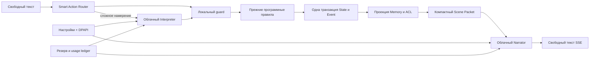

# Adventure Intelligence — дополнение к существующей архитектуре

AdventureLibrary хранит registry/FTS/provenance в adventure.sqlite3 и immutable originals/previews отдельно. Изолированный worker ограничивает размеры ZIP/PDF, память и время. Закрытые страницы обслуживаются только review session; player endpoint проверяет known media и reviewed variant на сервере.

AdventureDefinition описывает проверенные события, таблицы, трекеры, модули и scoped expedition rules. AdventureEngine вызывается внутри прежних Store.apply/engine_event транзакций и участвует в undo/memory. AI не утверждает определение и не исполняет произвольный JSON. Source analysis возвращает requires_review с проверенными цитатами.

CloudLLM сохраняет единый HTTPS/DPAPI/SSE/cost adapter; ai_roles выбирает одну роль явно, ActionValidator проверяет Qwen intent до natural guard/Ruleset. DeepSeek/Venice используют общий SceneCompiler. Gemini необязательна и работает только в opt-in source preparation. Состояние канона не зависит от выбора рассказчика.

Ограничения реализации и подтверждённый объём: REPORT-ADVENTURE.md. Следующий раздел описывает предыдущую архитектуру 2.1.

# Solo Realms AI 2.1 — дополнения Obsidian Chronicle

Существующий монолит и canonical journal сохранены. Схема кампаний 10 обозначает расширенный JSON-контракт героя (языки, подкласс, характер, цели/связи); прежние строки не переписаны. Старый EXE отклоняет новую схему, откат использует исходную копию профиля.

- `solo/preparation.py` и отдельный `preparation.sqlite3`: черновики с ревизией, оригиналы источников/хеши, страницы/чанки и GM-only FTS. Ограниченное извлечение PDF, исключение источника без удаления оригинала, версия правил фиксируется до запуска. Мир создаётся по явной разметке/JSON; перед вставкой кампании проверяются герой, ресурсы и согласия. Повтор запуска идемпотентен.
- `solo/selection.py`: валидируемый публичный контекст предмета/NPC/клетки/способности. Сам выбор read-only; зарегистрированное текстовое действие проходит прежние механические проверки. Секреты из выбранной сущности не передаются клиенту.
- `web/obsidian.*`, `chronicle.js`, `preparation.js`, `inventory.js`, `combat.js`: общая оболочка, отдельные настройки, информационные экраны; карта рисует серверную геометрию и подтверждённые события. Редакторские инструменты скрыты в режиме разработчика.
- `visual_catalog/source/`: неизменённый пользовательский каталог. `visual_catalog/assets.sqlite3` — отдельный публичный реестр. `web/visual/` содержит 65 нормализованных ресурсов/миниатюр, манифест хешей, авторство и лицензии. Кэш оригиналов находится в исключённом из Git `data/asset-cache/`.
- `solo/groq.py`, прежние cloud settings/ledger: выключенный пресет, проверка фактического `/models`, квоты/cooldown и один явно разрешённый ограниченный повтор 429 до токенов. Thinking-параметры зависят от модели; real API в этом цикле не проверялся. Новых постоянных AI-вызовов нет.
- `solo/desktop_observations.py`: собственный проверочный режим приложения для frozen/native запуска, локальных ресурсов, шрифтов, масштаба и защищённого выхода. Он использует только отдельные синтетические профили.

Локальный backend не запускает модели, голос или музыку. Новая нейросетевая проза требует настроенного внешнего API. [Фактический итог](REPORT-OBSIDIAN21.md).

# Историческая архитектура Solo Realms AI 2.0 — этапы 0–8

Существующий Python/FastAPI + SQLite/WAL + HTML/CSS/JS монолит сохранён. Интерфейс/backend на 127.0.0.1:8000. Единственный активный inference adapter — CloudLLM, внешние HTTPS OpenAI-compatible Chat Completions. Локального AI fallback и запуска порта 5001 в текущем Start.cmd нет.

- solo/game.py/natural.py: прежняя идемпотентность, operation lock, уточнения, текстовое путешествие и проверка намерения. Облачная scope привязывает расходы к campaign/request; не создаёт механических исходов.
- solo/storage.py: schema 9, canonical state/events и checkpoints, undo/restore/ветви. Memory update в той же транзакции. Проза и API costs не являются источниками state.
- solo/memory.py: сущности/алиасы, source event, provenance/truth/scope, knowledge grants, FTS5+ранжирование. Retrieval только из активной ветви, as-of для регенерации; секреты не уходят Narrator. Биография/география/состояния ссылаются на canonical State, не дублируют его вторым мировым движком.
- SceneCompiler: ограниченный профиль, открытая сцена, подтверждённые исходы и несколько относящихся воспоминаний. Прежняя невалидированная проза не включается как факт. Profile prompt не меняет арифметику.
- solo/model_protocol.py: независимый контракт Interpretation/Plan, plain/legacy structured presentation и GM topics. Результат парсинга не равен смысловой корректности.
- solo/cloud.py: persistent httpx, standard role messages, SSE/non-streaming, timeout/error/cancel, capability-conditioned parameters. Не запускает процессов, не загружает весов, не вызывает генерацию при старте, не выполняет tool_calls и не делает платных автоповторов.
- solo/cloud_settings.py: валидируемые профили без ключей, отдельный Windows CurrentUser DPAPI vault, one-way key update. Data/ не попадает в Git/кампании. Frontend не получает сохранённое значение.
- solo/cloud_cost.py: отдельная SQLite бухгалтерия, микровалютные целые, reservations/limits/one-shot approvals, provider usage и явно обозначенные estimates. Game undo не отменяет оплаченные API обращения. Валюты не смешиваются.
- web/: старый литературный центр и три темы, добавлены подключения и расходы. Ключ transient input отправляется только локальному backend. Предложения/описания через textContent, CSP same-origin. Общая оболочка, профили, правила и Canvas боя используют единую систему темы.

Обычный ясный разговор — один Narrator; сложный план — Interpreter+Narrator; тривиальные правила/сохранения — без AI. Рутинная память не добавляет API вызова. Offline history/saves доступны; новой нейросетевой прозы без API нет.

Частичные версионируемые D&D-пресеты и базовый бой реализованы: rulesets/rules_api, geometry/combat/combat_service/combat_api и серверная проекция combat_view. Combat state находится в том же canonical journal, а не отдельной несогласованной базе. maps.py генерирует и проверяет многослойное поле; geometry управляет LOS/светом/дверями, combat_view отдаёт только наблюдения. Визуальные текстуры не определяют механику. inventory/inventory_service/inventory_api хранят вещи/владельцев/снаряжение и предложения сделок; все ресурсные изменения коммитятся через engine_event. Предложения имеют TTL/version/hash. Полного мирового движка и Windows EXE пока нет. Прошлая архитектура сохранена в reports/cloud2/history/documents/.

WorldService/WorldProject: тот же travel resolver для UI/текста; наблюдения отдельно от текущего закрытого мира; NPC-only evidence только Memory ACL. Импорт добавляет валидируемый граф/события без кода и перезаписи прежних локаций. Центральный journal обновляет события часов после зарегистрированных действий; Narrator получает лишь наблюдаемый контекст.

Desktop: PyWebView/WinForms/EdgeChromium, встроенный uvicorn в потоке того же frozen процесса. HttpOnly session/bootstrap cookie и Origin/Host guards, без произвольного JS/Python bridge. Installed assets только для чтения, пользовательский профиль отдельно в LOCALAPPDATA, SQL snapshot/DPAPI копии перед миграцией/после закрытия. Inno Setup обновляет приложение с одним AppId; профиль не входит в uninstall log.
